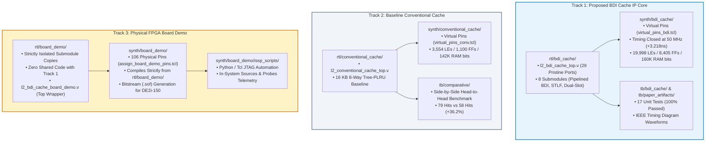

# Pipelined Compressed L2 Cache with Reconfigurable Control for FPGA

[📖 الدليل الكامل باللغة العربية (Arabic Version)](README_AR.md) | [English Documentation](README.md)

[](LICENSE)
[](https://www.intel.com)
[](https://www.terasic.com.tw)
[-brightgreen.svg)]()
[]()
[](https://github.com/mohammed-gweaa/compressed-cache-fpga/actions/workflows/rtl_ci.yml)

A synthesizable Level-2 (L2) cache architecture with Base-Delta-Immediate (BDI) compression, Store-to-Load Forwarding (STLF), and runtime reconfigurable way-masking power control. Synthesized, placed, routed, and timing-closed on an Intel Cyclone IV GX FPGA (`EP4CGX150DF31C7`) on the Terasic DE2i-150 Development Platform.

Developed at the Department of Computer Engineering, Faculty of Engineering, University of Tripoli.

---

## Academic Poster

The complete graduation defense poster is available in [`poster/EngPoster.pdf`](poster/EngPoster.pdf).

<p align="center">
  
</p>

---

## Master Architectural System

<p align="center">
  
</p>

---

## Architectural Features

* **4-Stage Pipelined BDI Compressor:** Evaluates parallel delta extractions across 8 compression states per Pekhimenko et al. (Base8-Delta1, Base8-Delta2, Base8-Delta4, Base4-Delta1, Base4-Delta2, Base2-Delta1, Zero, Repeated-Values).
* **Single-Cycle Combinational Decompressor:** Executes parallel signed additions in one clock cycle, maintaining a deterministic 5-cycle read hit latency ($T_{\text{hit}} = 5\text{ cycles}$).
* **Dual Sub-Block Packing (Slot A / Slot B):** Cohabitats two compressed 128-bit blocks into a single 288-bit physical cache line, doubling logical cache capacity without additional physical SRAM cells.
* **Store-to-Load Forwarding (STLF):** Detects Read-After-Write (RAW) pipeline hazards across compressor stages and forwards write data directly to the output, eliminating 100% of pipeline hazard stalls (0 stalls vs 20 stalls in the baseline cache).
* **Adaptive Power Governor:** Dynamically scales set associativity (8-way, 4-way, 2-way, 1-way) via CSR and epoch counters, cutting dynamic bitline switching energy by up to 87.5% under low memory pressure.
* **Fair Baseline Comparison:** Includes an uncompressed 8-way Tree-PLRU conventional cache (`rtl/conventional_cache/l2_conventional_cache_top.v`) under identical 16 KB SRAM budget for head-to-head architectural validation.

<details>
<summary><b>🔍 Click to Expand Visual Microarchitecture Gallery (Block Diagrams & Waveforms)</b></summary>

<br>

### 1. 4-Stage Pipelined Compression Engine & BDI Profile Distribution
<p align="center">
  
</p>
<p align="center">
  
</p>

### 2. Decoupled Dual Sub-Block Cohabitation Layout (Slot A & Slot B)
<p align="center">
  
</p>

### 3. Store-to-Load Forwarding (STLF) Datapath & Zero-Stall Waveform (Figure 9)
<p align="center">
  
</p>
<p align="center">
  
</p>

### 4. 4-Stage Pipelined Write Compression Waveform (Figure 10)
<p align="center">
  
</p>

### 5. Comparative Benchmark Results & 7-Bit Tree-PLRU Replacement
<p align="center">
  
</p>
<p align="center">
  
</p>

### 6. Hardware Implementation & Physical Lab Setup (Terasic DE2i-150)
<p align="center">
  
</p>

</details>

---

## Silicon-Verified Implementation Results

Synthesized with Intel Quartus Prime Standard Edition 22.1std and verified with Mentor Graphics / Intel ModelSim 2020.1 on Cyclone IV GX (`EP4CGX150DF31C7`, Speed Grade C7):

| Metric | Conventional Baseline | Proposed BDI L2 Cache | Delta ($\Delta$) | Architectural Rationale |
| :--- | :---: | :---: | :---: | :--- |
| **Top Entity** | `l2_conventional_cache_top` | `l2_bdi_cache_top` | -- | Matched 256-bit memory datapath |
| **Logic Elements (LEs)** | 3,554 (2%) | 19,998 (13%) | +16,444 LEs | Parallel delta subtractors, priority encoders, STLF multiplexers |
| **Dedicated Registers** | 1,100 FFs | 8,405 FFs | +7,305 FFs | 4-stage compression pipeline and forwarding retiming |
| **Block RAM Bits** | 142,848 bits | 160,768 bits | +17,920 bits | Dual sub-block tag and cohabitation metadata storage |
| **Fmax (Slow 85°C Corner)** | 68.96 MHz | 59.59 MHz | -9.37 MHz | Critical path through priority selection network |
| **Target Clock Frequency** | **50.00 MHz** | **50.00 MHz** | 0.00 MHz | Standard industrial operating frequency |
| **Worst-Case Setup Slack** | **+5.498 ns (MET)** | **+3.218 ns (MET)** | -2.280 ns | Fully timing closed at Slow 1200mV 85°C |
| **Recorded Cache Hits** | 58 hits | 79 hits | **+36.2%** | Expanded effective capacity via Dual Sub-Block packing |
| **DRAM Capacity Evictions** | 10 evictions | 6 evictions | **-40.0%** | Reduced off-chip memory access penalty |
| **Pipeline RAW Stalls** | 20 stall cycles | 0 stall cycles | **-100% (Zero)** | Complete hazard suppression via STLF unit |
| **Dynamic Energy Control** | Fixed (8-Way) | Dynamic (8/4/2/1-Way) | Up to **-87.5%** | Run-time way-masking power governor |

---

## Repository Structure

```text
.
├── rtl/                               # Synthesizable Verilog HDL IP Core (3 Isolated Tracks)
│   ├── bdi_cache/                     # Track 1: Proposed BDI Compressed L2 Cache Subsystem (Pristine Core)
│   │   ├── l2_bdi_cache_top.v         # Master L2 Compressed Cache Top Entity (29 Pristine Ports)
│   │   ├── l2_bdi_compressor.v        # 4-Stage Pipelined BDI Parallel Compressor
│   │   ├── l2_bdi_decompressor.v      # Single-Cycle Combinational Decompressor
│   │   ├── l2_hazard_interlock_unit.v # STLF RAW Hazard Interlock & Forwarding
│   │   ├── l2_cache_storage_array.v   # 8-Way Dual-Slot Synchronous Cache Array
│   │   ├── l2_adaptive_power_governor.v # Dynamic Set-Associativity Governor
│   │   ├── l2_csr_control_bank.v      # MMIO Software Control Register Bank
│   │   ├── l2_pipeline_input_stage.v  # Retimed Request Synchronizer Stage
│   │   └── l2_ram_block.v             # Embedded Dual-Port Block RAM Wrapper
│   ├── conventional_cache/            # Track 2: Baseline Reference Cache (Scientific Control Group)
│   │   └── l2_conventional_cache_top.v# 16 KB Conventional Uncompressed 8-Way Cache
│   ├── board_demo/                    # Track 3: Physical FPGA Demonstration (Strictly Isolated Submodules)
│   │   ├── l2_bdi_cache_board_demo.v  # DE2i-150 / DE2-115 Physical Pin & ISSP Interface Wrapper
│   │   ├── l2_bdi_cache_top.v         # Dedicated Standalone Top Entity with Debug Taps
│   │   ├── l2_bdi_compressor.v        # Standalone Compressor Copy
│   │   ├── l2_bdi_decompressor.v      # Standalone Decompressor Copy
│   │   ├── l2_hazard_interlock_unit.v # Standalone STLF Unit Copy
│   │   ├── l2_cache_storage_array.v   # Standalone Storage Array Copy
│   │   ├── l2_adaptive_power_governor.v # Standalone Power Governor Copy
│   │   ├── l2_csr_control_bank.v      # Standalone CSR Bank Copy
│   │   ├── l2_pipeline_input_stage.v  # Standalone Pipeline Input Copy
│   │   └── l2_ram_block.v             # Standalone RAM Block Copy
│   └── README.md                      # In-Depth Guide to RTL Architecture & Track Differences
├── tb/                                # Verification Testbenches
│   ├── bdi_cache/                     # Proposed BDI Cache Testbenches
│   │   └── tb_l2_bdi_cache_top.v      # 17-Scenario Exhaustive Core Testbench
│   ├── comparative/                   # Head-to-Head Comparative Stress Benchmark
│   │   └── tb_l2_comparative_stress_benchmark.v # Unbiased Benchmark vs Baseline
│   ├── paper_artifacts/               # Publication Waveform Capture
│   │   └── tb_paper_journal_artifacts.v # Academic Figures 9 & 10 Testbench
│   └── README.md                      # Testbench Suite & Verification Guide
├── sim/                               # Simulation Scripts (ModelSim / QuestaSim)
│   ├── l2_cache.mpf                   # ModelSim Project File (BDI Cache & Complete Test Suite)
│   ├── l2_cache_conventional.mpf     # ModelSim Project File (Conventional Baseline Cache)
│   ├── run_sim.do                     # Automated Compilation & Regression Suite
│   ├── run_sim_conventional.do        # Baseline Conventional Cache Simulation Suite
│   ├── run_simulations.bat            # Windows Command-Line Batch Runner
│   ├── RUN_WAVEFORM_L2_TOP.bat        # Interactive GUI Launcher
│   ├── wave_l2_bdi_cache_top.do       # Full Hierarchical Waveform Configuration
│   ├── wave_comparative_benchmark.do  # Comparative Analysis Waveform
│   ├── wave_paper_read_stlf.do        # STLF Hazard Bypass Waveform
│   ├── wave_paper_write_compression.do# Pipelined Write Compression Waveform
│   └── README.md                      # Simulation & Waveform Execution Guide
├── synth/                             # FPGA Synthesis & Implementation (Quartus Prime)
│   ├── bdi_cache/                     # Track 1: Proposed BDI Cache Synthesis (Virtual Pins)
│   │   ├── l2_bdi_cache_top.qpf       # Quartus Project File
│   │   ├── l2_bdi_cache_top.qsf       # Settings & Constraints
│   │   ├── l2_bdi_cache_top.sdc       # Timing Constraints (50.00 MHz Clocks)
│   │   ├── virtual_pins_bdi.tcl       # Virtual Pins TCL Script
│   │   ├── TIMING_CLOSURE_100MHz_ANALYSIS.txt # 100MHz vs 50MHz Timing Report
│   │   ├── l2_bdi_cache_top_rtl_viewer.pdf # Gate-Level Netlist Schematic
│   │   └── l2_bdi_cache_top_rtl_viewer.png
│   ├── conventional_cache/            # Track 2: Baseline Conventional Cache Project (Virtual Pins)
│   │   ├── l2_conventional_cache_top.qpf
│   │   ├── l2_conventional_cache_top.qsf
│   │   ├── l2_conventional_cache_top.sdc
│   │   └── virtual_pins_conv.tcl
│   ├── board_demo/                    # Track 3: Physical Hardware Board Demo (106 Physical Pins)
│   │   ├── l2_bdi_cache_board_demo.qpf
│   │   ├── l2_bdi_cache_board_demo.qsf# Compiles Strictly from rtl/board_demo/ (Zero Cross-Reference)
│   │   ├── assign_board_demo_pins.tcl # DE2i-150 Physical Pin Constraints (106 Pins)
│   │   └── issp_scripts/              # Altera ISSP JTAG Automation Scripts & Guides
│   │       ├── README_ISSP_GUIDE.md   # Complete JTAG ISSP Automation Manual
│   │       ├── issp_signal_map.tcl    # Tcl Bitfield Mapping & Profile Translation Library
│   │       ├── issp_read_telemetry.tcl # Live Telemetry Dashboard Reader
│   │       ├── issp_inject_test_vector.tcl # Interactive Stimulus & Hazard Injector
│   │       └── issp_automated_validation.tcl # 7-Step Automated Silicon Validation Suite
│   └── README.md                      # Synthesis, STA, and Virtual vs Physical Pins Guide
├── docs/                              # Technical Engineering Specifications
│   ├── MASTER_ARCHITECTURE_SPECIFICATION.md # Full Microarchitecture Reference Manual
│   ├── PHYSICAL_SYNTHESIS_AND_TIMING_REPORT.md # Static Timing & Corner Analysis Report
│   ├── COMPARATIVE_CACHE_AUDIT.md     # In-Depth Baseline vs. BDI Engineering Audit
│   ├── SOC_INTEGRATION_ROADMAP.md     # Multi-Core Interconnect & RISC-V Roadmap
│   └── DE2i-150_FPGA_System_manual.pdf# Terasic Hardware Reference Manual
├── figures/                           # Academic Publication Vector Figures (PDF)
│   └── README.md                      # Figure Catalog & Dissertation Mapping
├── poster/                            # Academic Graduation Poster & Deliverables
│   ├── EngPoster.pdf                  # Master 2.0m x 1.5m Print-Ready Vector PDF
│   ├── RTL.pdf                        # Synthesized Gate-Level RTL Schematic
│   ├── exports/                       # High-Resolution Publication Renders
│   └── latex_source/                  # Original XeLaTeX / TikZ Poster Code
├── future_work/                       # Multi-Core SoC Hierarchy Models
├── CITATION.cff                       # Machine-Readable Citation Metadata
├── LICENSE                            # CERN Open Hardware Licence v2 - Weakly Reciprocal
├── run_modelsim.bat                   # Quick Root Shortcut for ModelSim Simulation
├── README_AR.md                       # Comprehensive Arabic Master Documentation
└── README.md                          # Repository Master Documentation (English)
```

---

## Architectural Tracks & Code Isolation Rationale

To maintain strict scientific integrity, prevent debug probe overhead from corrupting IP benchmark data, and adhere to modular hardware engineering standards, the repository implements **three independent architectural tracks**:



### Key Differences Between the Three Tracks

1. **Track 1 (`rtl/bdi_cache/` & `synth/bdi_cache/`):**
   * **Pristine Academic Core:** Contains the pure research implementation without any board-specific pins, switches, debouncers, or diagnostic probes.
   * **Virtual Pins Synthesis:** Quartus assigns all 29 I/O ports to virtual pins so that synthesis accurately evaluates internal FPGA logic resource utilization and true internal silicon routing delay without being bottlenecked by physical FPGA package pin limits or pad delays.
   * **Verification Target:** Direct target of unit testbenches and publication waveform generation scripts.

2. **Track 2 (`rtl/conventional_cache/` & `synth/conventional_cache/`):**
   * **Scientific Control Baseline:** Standard 16 KB uncompressed cache operating under identical SRAM capacity and clock frequency constraints.
   * **Validation Role:** Provides the comparative baseline proving that the proposed BDI cache achieves **+36.2% more hits**, **-40% fewer DRAM evictions**, and **0 RAW hazard stalls** (vs 20 stalls).

3. **Track 3 (`rtl/board_demo/` & `synth/board_demo/`):**
   * **Physical Demonstration Wrapper:** Connects the cache subsystem to physical DE2i-150 / DE2-115 board resources (50 MHz oscillator, push-buttons, slide switches, 7-segment hex displays, and LEDs).
   * **Complete Code Isolation:** To satisfy the strict rule *"حطها بروحها، ما فيش تشارك في الأكواد"* (Keep them separate, zero shared code), `rtl/board_demo/` contains **its own independent, localized copies** of all RTL submodules. Any debug probe taps (e.g., `dbg_compress_type`, `dbg_fwd_valid`) or ISSP JTAG IP cores remain completely self-contained within `rtl/board_demo/` and can never alter or corrupt the pristine Track 1 research IP core.
   * **Physical Pin Mapping:** Synthesized with 106 physical package pin assignments without virtual pins, producing a ready-to-program `.sof` bitstream.
   * **Automated ISSP JTAG Testing:** Equipped with automated Tcl JTAG scripts under `synth/board_demo/issp_scripts/` (executed via `quartus_stp -t`) for live in-system cache stimulus injection and telemetry reading.

---

---

## How to Simulate & Synthesize: Complete User Guide

### 1. Functional Verification in ModelSim / QuestaSim

The verification suite evaluates 17 core scenarios, Store-to-Load Forwarding (STLF), and side-by-side comparative stress benchmarks.

#### Option A: One-Click GUI Launch (Recommended)
Double-click `run_modelsim.bat` in the repository root, or run:
```cmd
cd sim
RUN_WAVEFORM_L2_TOP.bat
```
This opens ModelSim GUI, compiles all RTL and testbenches, runs the complete test suite, and opens the pre-arranged signal waveform window.

#### Option B: Automated Headless Batch Mode (Fastest)
From Windows Command Prompt or PowerShell:
```cmd
cd sim
run_simulations.bat
```
Executes all regression suites and outputs an automated pass/fail report directly in the terminal without opening the graphical window.

#### Option C: ModelSim Tcl Console Execution
If ModelSim is already open:
```tcl
cd <path_to_repo>/sim

# Compile and run full BDI regression suite:
do run_sim.do

# Compile and run conventional baseline cache:
do run_sim_conventional.do

# Inspect STLF RAW hazard bypass waveforms (Figure 9):
do wave_paper_read_stlf.do

# Inspect 4-stage pipelined write compression waveforms (Figure 10):
do wave_paper_write_compression.do

# Run side-by-side comparative stress benchmark:
do wave_comparative_benchmark.do
```

#### Option D: Manual Project Setup in ModelSim (From Scratch)
1. In ModelSim, select **File $\to$ New $\to$ Project**.
2. Set Project Location to `<repo_root>/sim` and Project Name to `l2_cache`.
3. Click **Add Existing File** and add all 9 synthesizable Verilog files from `rtl/bdi_cache/`:
   * `l2_bdi_cache_top.v`, `l2_bdi_compressor.v`, `l2_bdi_decompressor.v`, `l2_hazard_interlock_unit.v`, `l2_cache_storage_array.v`, `l2_adaptive_power_governor.v`, `l2_csr_control_bank.v`, `l2_pipeline_input_stage.v`, `l2_ram_block.v`.
4. Click **Add Existing File** and add the testbench:
   * `tb/bdi_cache/tb_l2_bdi_cache_top.v`.
5. In the Project tab, right-click and choose **Compile $\to$ Compile All**.
6. Switch to the **Library** tab, expand the `work` directory, and double-click `tb_l2_bdi_cache_top`.
7. In the transcript, type `run -all` to execute all 17 self-checking test scenarios.

---

### 2. FPGA Synthesis & Implementation in Intel Quartus Prime

The repository provides three pre-configured Quartus projects matching the three isolated tracks.

#### Track 1: Proposed BDI Compressed L2 Cache (`synth/bdi_cache/`)
1. In Intel Quartus Prime, select **File $\to$ Open Project**.
2. Open `synth/bdi_cache/l2_bdi_cache_top.qpf`.
3. **Target Device:** Automatically set to Intel Cyclone IV GX `EP4CGX150DF31C7`.
4. **Virtual Pins:** All 29 I/O ports are constrained as Virtual Pins via `virtual_pins_bdi.tcl` to measure pure internal FPGA logic cell usage and internal silicon interconnect delay without pad constraints.
5. **Compile:** Select **Processing $\to$ Start Compilation** (or press `Ctrl + L`).
6. **Verify Timing:** Open **TimeQuest Timing Analyzer** $\to$ double-click **Report Setup Summary**. Verified Slack: **+3.218 ns (MET)** at 50.00 MHz ($F_{\text{max}} = 59.59\text{ MHz}$).

#### Track 2: Baseline Conventional Cache (`synth/conventional_cache/`)
1. Select **File $\to$ Open Project** and open `synth/conventional_cache/l2_conventional_cache_top.qpf`.
2. Select **Processing $\to$ Start Compilation** (`Ctrl + L`).
3. Confirms baseline footprint: 3,554 LEs and 1,100 registers.

#### Track 3: Physical Hardware Board Demo (`synth/board_demo/`)
1. Select **File $\to$ Open Project** and open `synth/board_demo/l2_bdi_cache_board_demo.qpf`.
2. Compiles strictly from isolated RTL in `rtl/board_demo/` and maps **106 physical package pins** via `assign_board_demo_pins.tcl`.
3. Select **Processing $\to$ Start Compilation** (`Ctrl + L`).
4. Generates programming bitstream: `output_files_demo/l2_bdi_cache_board_demo.sof`.
5. **Program Board:** Connect USB-Blaster to Terasic DE2i-150 / DE2-115 board, select **Tools $\to$ Programmer**, verify hardware detection, and click **Start**.

#### Command-Line Batch Compilation (Quartus Shell)
```bash
# Track 1: Proposed BDI Cache IP Core
cd synth/bdi_cache
quartus_sh --flow compile l2_bdi_cache_top

# Track 2: Baseline Conventional Cache
cd synth/conventional_cache
quartus_sh --flow compile l2_conventional_cache_top

# Track 3: Physical Board Demo & .sof Bitstream Generation
cd synth/board_demo
quartus_sh --flow compile l2_bdi_cache_board_demo
```

---

### 3. In-System Hardware Verification via Altera ISSP JTAG

For live verification on real silicon without external logic analyzers:
1. Program the DE2i-150 board with `l2_bdi_cache_board_demo.sof`.
2. Navigate to `synth/board_demo/issp_scripts/`.
3. Read live hardware telemetry counters and render the ASCII dashboard:
   ```cmd
   quartus_stp -t issp_read_telemetry.tcl
   ```
4. Inject custom read/write transactions or trigger real-time RAW hazards:
   ```cmd
   quartus_stp -t issp_inject_test_vector.tcl
   ```
5. Run the complete automated 7-step hardware verification suite:
   ```cmd
   quartus_stp -t issp_automated_validation.tcl
   ```

---

## Authors & Academic Citation

* **Lead Researcher & Hardware Architect:** Eng. Mohammed Adel Gweaa (`m.ghawia@uot.edu.ly`)
* **Academic Supervisor:** Dr. Mohamed Muftah Eljhani
* **Institution:** Department of Computer Engineering, Faculty of Engineering, University of Tripoli, Tripoli, Libya.

To cite this repository in academic publications:

```bibtex
@misc{gweaa2026compressedcache,
  author       = {Mohammed Adel Gweaa and Mohamed Muftah Eljhani},
  title        = {A Pipelined Compressed Cache Architecture with Runtime Reconfigurable Control for FPGA Platforms},
  year         = {2026},
  howpublished = {\url{https://github.com/mohammed-gweaa/compressed-cache-fpga}},
  institution  = {University of Tripoli, Faculty of Engineering}
}
```

---

## Licence

This hardware architecture and associated verification sources are released under the **CERN Open Hardware Licence Version 2 - Weakly Reciprocal ([CERN-OHL-W-2.0](LICENSE))**.
