# معمارية كاش المستوى الثاني (L2) المضغوط والممرحل مع تحكم ديناميكي قابل لإعادة التشكيل على مصفوفات الـ FPGA
## Pipelined Compressed L2 Cache with Reconfigurable Control for FPGA

[English Documentation](README.md) | [📖 النسخة العربية](README_AR.md)

[](LICENSE)
[](https://www.intel.com)
[](https://www.terasic.com.tw)
[-brightgreen.svg)]()
[]()
[](https://github.com/mohammed-gweaa/compressed-cache-fpga/actions/workflows/rtl_ci.yml)

تصميم عتادي قابل للتوليف والتصنيع (Synthesizable IP Core) لذاكرة كاش المستوى الثاني (Level-2 Cache) مدمج به خوارزمية ضغط العتاد المتوازي Base-Delta-Immediate (BDI)، مع وحدة تمرير البيانات السريع لتفادي التعارضات (Store-to-Load Forwarding - STLF)، ونظام تحكم تكيفي ديناميكي في استهلاك الطاقة عبر حجب خطوط الارتباطية (Way-Masking Power Governor).

تم توليف المعمارية ووضعها وتوجيه مساراتها وإغلاق توقيتها الزمني بالكامل (Timing Closure) على شريحة **Intel Cyclone IV GX (`EP4CGX150DF31C7`)** المثبتة على منصة التطوير **Terasic DE2i-150**.

* **الباحث ومصمم المعمارية العتادية:** المهندس محمد عادل قيعاء (`m.ghawia@uot.edu.ly`)
* **المشرف الأكاديمي:** الدكتور محمد مفتاح الجهاني
* **الجهة الأكاديمية:** قسم هندسة الحاسوب، كلية الهندسة، جامعة طرابلس، طرابلس - ليبيا.

---

## البوستر الأكاديمي لمشروع التخرج

الملف الفيكتوري الأصلي المخصص للطباعة بحجم عالي الدقة (2.0 متر × 1.5 متر) متوفر في [`poster/EngPoster.pdf`](poster/EngPoster.pdf).

<p align="center">
  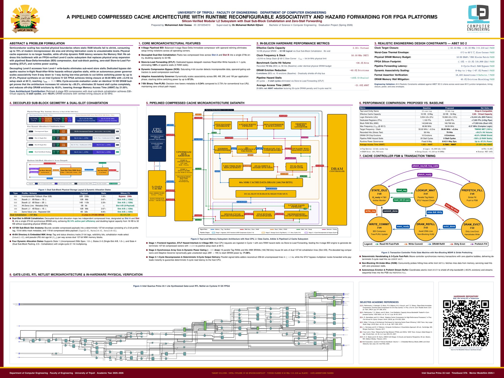
</p>

---

## المخطط المعماري الشامل للنظام (System Architecture)

<p align="center">
  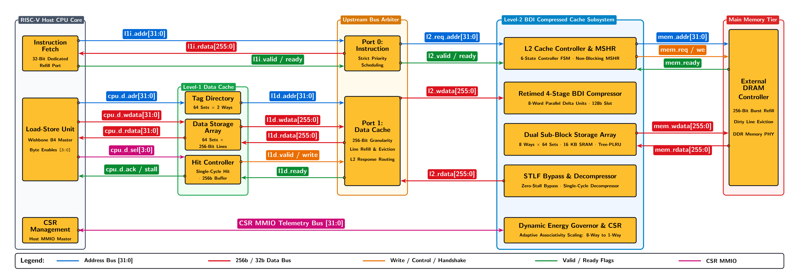
</p>

---

## الخصائص والابتكارات المعمارية الرئيسية

1. **ضاغط BDI ممرحل على 4 مراحل (4-Stage Pipelined Compressor):**
   * يفحص 8 أنماط ضغط بالتوازي وفق خوارزمية Pekhimenko:
     `(Base8-Delta1, Base8-Delta2, Base8-Delta4, Base4-Delta1, Base4-Delta2, Base2-Delta1, Zero, Repeated-Values)`.
   * مزود بوحدة التجاوز الديناميكي للضغط (Dynamic Compression Bypass - DCB) عبر عداد إشباع 4-bit لتعطيل محاولات الضغط للبيانات غير القابلة للضغط أو المشفرة لتوفير طاقة التبديل.
2. **فاك ضغط توافقي في دورة ساعة واحدة (Single-Cycle Combinational Decompressor):**
   * ينفذ عمليات الجمع المتوازية ذات الإشارة في دورة ساعة واحدة فقط، مما يحافظ على زمن حتمي وثابت لوصول البيانات عند ضربة القراءة يبلغ 5 دورات ساعة ($T_{\text{hit}} = 5 \text{ cycles}$).
3. **التخزين المزدوج في خط الكاش (Decoupled Dual-Slot Cohabitation - Slot A / Slot B):**
   * يدمج كتلتين مضغوطتين (سعة كل منهما 128 بت) في خط كاش فيزيائي واحد بسعة 288 بت، مما يضاعف السعة المنطقية للكاش من 16 كيلوبايت إلى 32 كيلوبايت دون الحاجة إلى إضافة خلايا SRAM فيزيائية جديدة، وبكفاءة استغلال للمنافذ بلغت 95.14%.
4. **تمرير البيانات وتفادي التعارضات العتادية (Store-to-Load Forwarding - STLF):**
   * يكتشف تعارضات القراءة بعد الكتابة (RAW Hazards) عبر مراحل الضاغط الأربعة ومرحلة التثبيت، ويمرر البيانات غير المضغوطة مباشرة للمخرج، مما يلغي دورات التوقف بالكامل (0 دورة توقف مقابل 20 دورة في الكاش التقليدي).
5. **حاكم الطاقة التكيفي (Adaptive Power Governor):**
   * يراقب معدل إخفاق الكاش عبر نافذة انزلاقية من 1024 دورة ساعة. عند انخفاض العبء على الذاكرة (< 5% إخفاق)، يقلص الارتباطية تلقائياً من (8-Way $\to$ 4-Way $\to$ 2-Way $\to$ 1-Way)، مما يخفض طاقة التبديل الديناميكية لخطوط البت بنسبة تصل إلى 87.5%.
6. **مجموعة التحكم المرجعية العادلة (Conventional Baseline Comparison):**
   * يحتوي المستودع على كاش تقليدي 8-Way يعمل بخوارزمية Tree-PLRU بنفس ميزانية الـ SRAM البالغة 16 كيلوبايت لإجراء مقارنة علمية دقيقة ومحايدة.

<details>
<summary><b>🔍 انقر هنا لاستعراض معرض المخططات المعمارية وأشكال الموجات التفاعلية (Waveforms & Diagrams)</b></summary>

<br>

### 1. خط أنابيب ضغط BDI المُمرحل وتوزيع الأنماط الثمانية
<p align="center">
  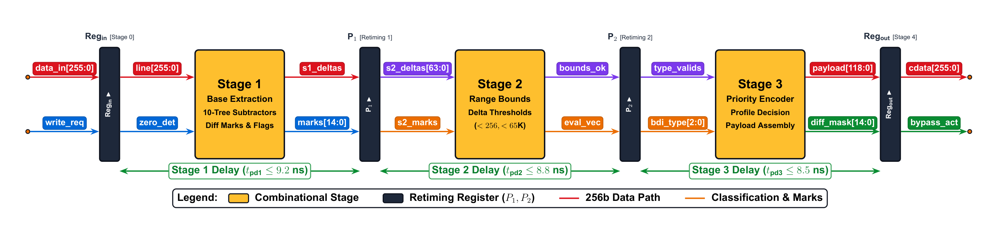
</p>
<p align="center">
  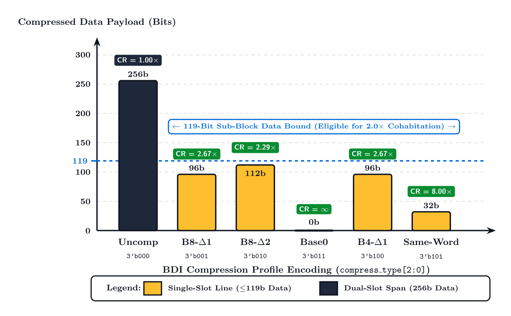
</p>

### 2. تقسيم خط التخزين المزدوج للكتل الفرعية (Slot A و Slot B)
<p align="center">
  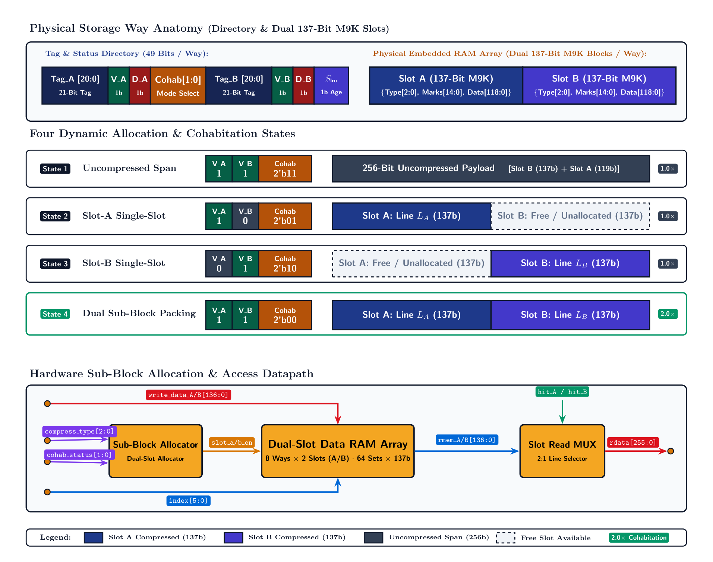
</p>

### 3. مسار بيانات تفادي التعارضات (STLF) وشكل الموجة الحتمي (الشكل 9)
<p align="center">
  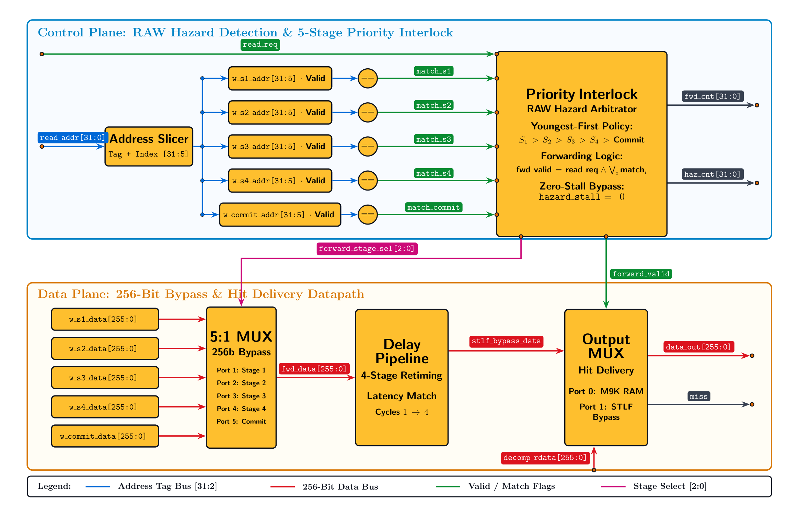
</p>
<p align="center">
  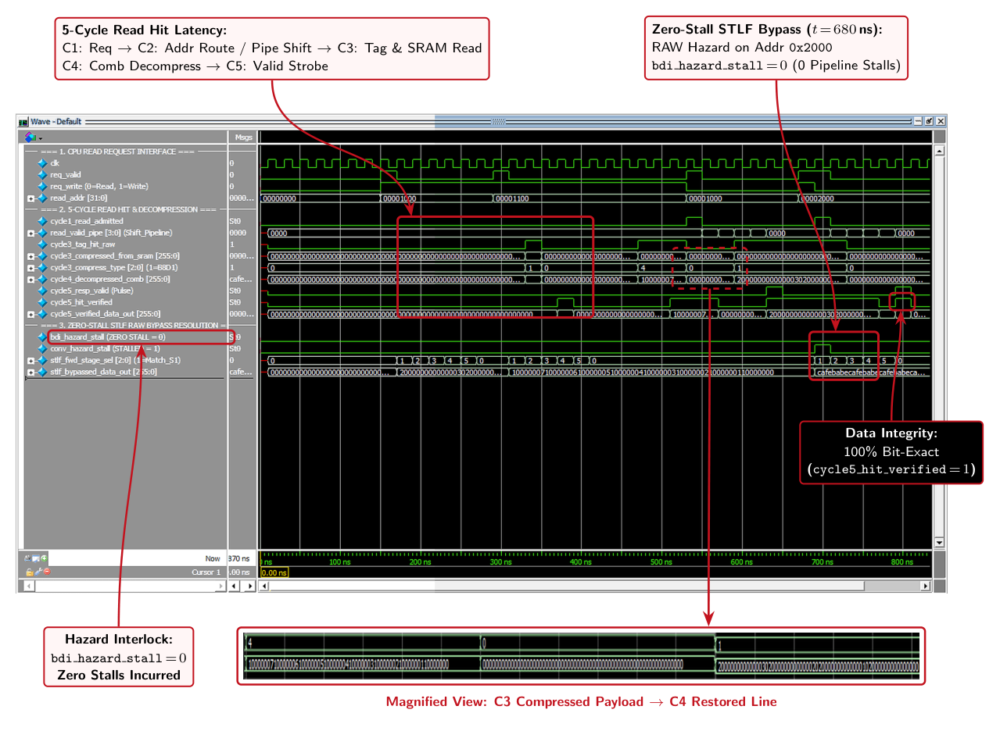
</p>

### 4. شكل الموجة الزمني لمراحل ضغط الكتابة (الشكل 10)
<p align="center">
  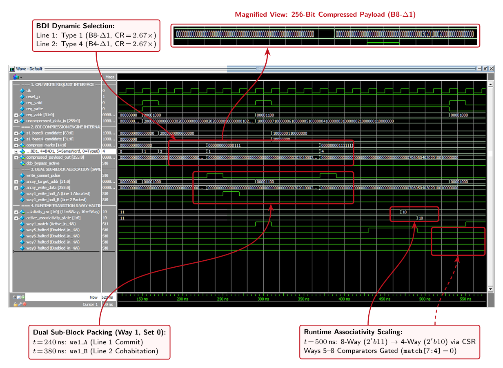
</p>

### 5. نتائج الاختبار المقارن المباشر وشجرة استبدال Tree-PLRU
<p align="center">
  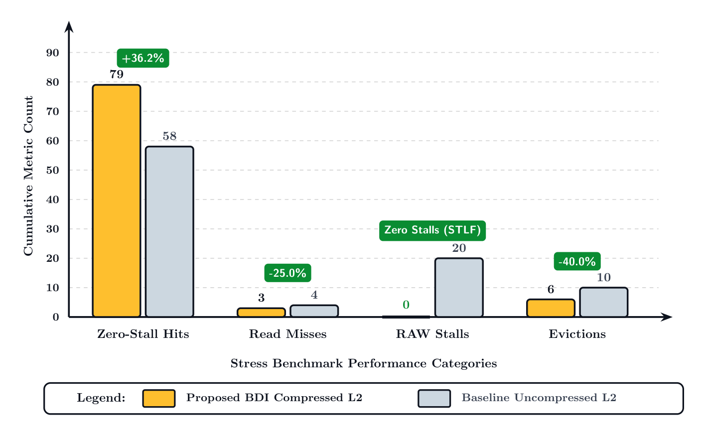
</p>
<p align="center">
  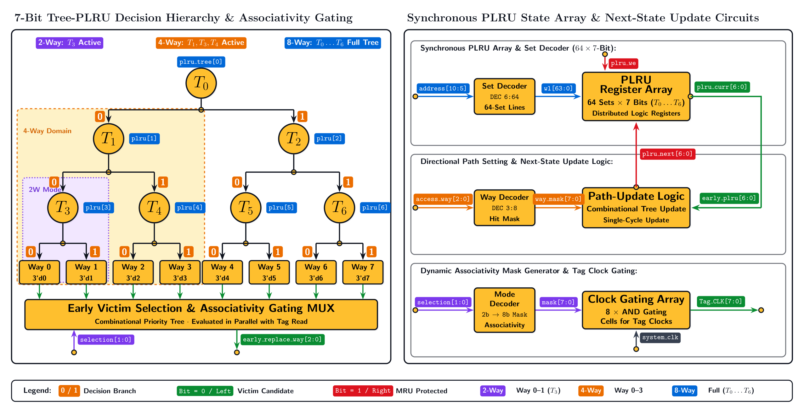
</p>

### 6. الإعداد العملي ومطابقة دبابيس لوحة Terasic DE2i-150 في المختبر
<p align="center">
  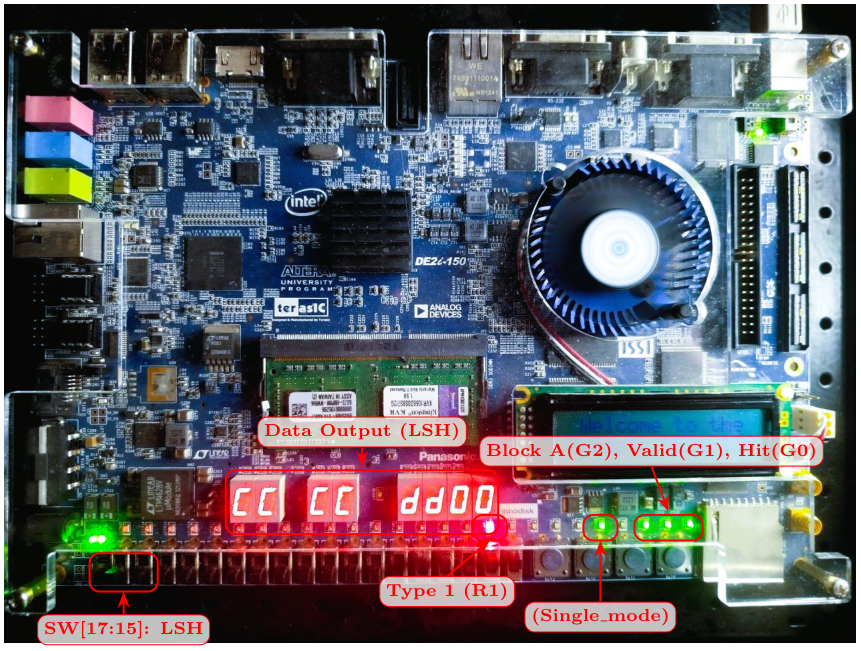
</p>

</details>

---

## نتائج التوليف والتحقق على السيليكون (Cyclone IV GX)

تم استخراج كافة النتائج الفيزيائية بدقة عبر **Intel Quartus Prime Standard Edition 22.1std** و **Mentor Graphics ModelSim 2020.1** على شريحة `EP4CGX150DF31C7` (فئة السرعة C7):

| المؤشر الهندسي | الكاش التقليدي المرجعي | كاش BDI المقترح | الفارق الهندسي ($\Delta$) | التفسير والتعليل المعماري |
| :--- | :---: | :---: | :---: | :--- |
| **الوحدة العليا (Top Entity)** | `l2_conventional_cache_top` | `l2_bdi_cache_top` | -- | مسار بيانات مطابق بسعة 256 بت |
| **عناصر المنطق (Logic Elements - LEs)** | 3,554 (2%) | 19,998 (13%) | +16,444 LEs | طارحات دلتا المتوازية، المشفرات ذات الأولوية، ومبدلات STLF |
| **سجلات التخزين (Registers / FFs)** | 1,100 FFs | 8,405 FFs | +7,305 FFs | مراحل خط أنابيب الضغط الأربعة ومسجلات إعادة التوقيت |
| **بتات الذاكرة المدمجة (Block RAM Bits)** | 142,848 بت | 160,768 بت | +17,920 بت | وسوم الكتلتين الفرعيتين وحقول التخزين المزدوج الإضافية |
| **التردد الأقصى ($F_{\text{max}}$ عند 85°C)** | 68.96 MHz | 59.59 MHz | -9.37 MHz | أطول مسار تأخير حرج يمر عبر شبكة فرز الأنماط ذات الأولوية |
| **تردد التشغيل المستهدف** | **50.00 MHz** | **50.00 MHz** | 0.00 MHz | التردد الصناعي المستهدف لكاش المستوى الثاني |
| **هامش التوقيت الحرج (Setup Slack)** | **+5.498 ns (MET)** | **+3.218 ns (MET)** | -2.280 ns | مغلق زمنياً بالكامل عند أسوأ زاوية تشغيل حرارية (Slow 85°C) |
| **عدد ضربات الكاش المسجلة (Hits)** | 58 ضربة | 79 ضربة | **+36.2%** | زيادة السعة الفعالة بفضل تخزين الكتلتين الفرعيتين |
| **عمليات الإخلاء إلى DRAM** | 10 إخلاءات | 6 إخلاءات | **-40.0%** | تقليل التردد على الذاكرة الخارجية البطيئة |
| **دورات التعطيل الناتجة عن RAW** | 20 دورة | 0 دورة | **-100% (تصفير)** | القضاء التام على التعارضات عبر وحدة الـ STLF |
| **التحكم في الطاقة الديناميكية** | ثابت (8-Way) | تكيفي (8/4/2/1-Way) | حتى **-87.5%** | خفض شحن وتفريغ خطوط البت عبر حجب الطرق غير المستخدمة |

---

## المسارات المعمارية الثلاثة المعزولة في المشروع

لضمان الدقة الأكاديمية الصارمة ومنع أي تداخل بين كود النواة النقية وكود منصة العرض، تم تقسيم الكود إلى **ثلاثة مسارات مستقلة تماماً**:

1. **المسار الأول (`rtl/bdi_cache/` و `synth/bdi_cache/`) - النواة البحثية النقية (Pristine Core):**
   * يتضمن التصميم الخالص للنواة بـ 29 منفذاً قياسياً دون أي دبابيس خاصة بلوحات العرض.
   * يتم توليفه باستخدام **الدبابيس الافتراضية (Virtual Pins)** عبر سكربت `virtual_pins_bdi.tcl` لقياس مساحة منطق السيليكون وسرعته الفعلية داخل الـ FPGA بمعزل عن قيود دبابيس الغلاف الخارجي.
2. **المسار الثاني (`rtl/conventional_cache/` و `synth/conventional_cache/`) - المجموعة المرجعية:**
   * كاش تقليدي قياسي بسعة 16KB لمقارنة الأداء والنتائج المعمارية تحت نفس ظروف التشغيل.
3. **المسار الثالث (`rtl/board_demo/` و `synth/board_demo/`) - العرض العملي الفيزيائي:**
   * يحتوي على نسخ مستقلة ومحلية بالكامل من كافة الوحدات الفرعية لمنع أي تعديل على كود النواة الأصلية.
   * مربوط بـ 106 دبابيس فيزيائية على لوحة DE2i-150 / DE2-115 لتشغيل المفاتيح وشاشات الـ 7-segment ومصابيح الـ LED.
   * متكامل مع واجهة **Altera ISSP (In-System Sources and Probes)** للحقن الآلي للاختبارات عبر JTAG وقراءة السجلات لحظياً عبر سكربتات Tcl الآلية الموجهة لبرنامج Quartus SignalTap.

---

## دليل الاستخدام الكامل: المحاكاة والتوليف خطوة بخطوة

### أولاً: المحاكاة عبر برنامج ModelSim / QuestaSim

تتوفر بيئة محاكاة جاهزة ومتكاملة لا تتطلب سوى خطوة واحدة لتشغيل بنك الاختبارات الكامل:

#### الخيار 1: التشغيل السريع المباشر (Windows Batch)
من موجه الأوامر (Command Prompt) أو بالنقر المزدوج:
* لتشغيل المحاكاة واستعراض النتائج في الطرفية:
  ```cmd
  cd sim
  run_simulations.bat
  ```
* لفتح واجهة ModelSim الرسومية مع تحميل إشارات الـ Waveform المجهزة مسبقاً:
  ```cmd
  cd sim
  RUN_WAVEFORM_L2_TOP.bat
  ```
  أو تشغيل الاختصار الجذري من المجلد الرئيسي للمشروع: `run_modelsim.bat`.

#### الخيار 2: التشغيل اليدوي من داخل واجهة ModelSim GUI
1. افتح برنامج ModelSim.
2. في شريط الأوامر السفلي (Transcript Console)، توجه لمجلد `sim`:
   ```tcl
   cd C:/mohammed_gweaa/sim
   ```
3. نفذ سكربت التصريف والمحاكاة التلقائي الشامل:
   ```tcl
   do run_sim.do
   ```
4. لاستعراض أشكال الموجات الخاصة بتجاوز التعارضات (STLF) المنشورة في الورقة العلمية (الشكل 9):
   ```tcl
   do wave_paper_read_stlf.do
   ```
5. لاستعراض أشكال الموجات لضغط خط الأنابيب (الشكل 10):
   ```tcl
   do wave_paper_write_compression.do
   ```
6. لتشغيل المحاكاة المقارنة بين الكاش المقترح والكاش التقليدي جنباً إلى جنب:
   ```tcl
   do wave_comparative_benchmark.do
   ```

#### الخيار 3: بناء مشروع محاكاة يدوي من الصفر في ModelSim (خطوة بخطوة)
إذا كنت ترغب بإنشاء المشروع يدوياً داخل ModelSim:
1. من القائمة اختر: **File $\to$ New $\to$ Project**.
2. حدد مسار المشروع: `C:/mohammed_gweaa/sim` واختر اسماً للمشروع (مثل `l2_cache`).
3. اضغط **Add Existing File** وأضف ملفات الـ RTL التالية من مجلد `rtl/bdi_cache/`:
   * `l2_bdi_cache_top.v`
   * `l2_bdi_compressor.v`
   * `l2_bdi_decompressor.v`
   * `l2_hazard_interlock_unit.v`
   * `l2_cache_storage_array.v`
   * `l2_adaptive_power_governor.v`
   * `l2_csr_control_bank.v`
   * `l2_pipeline_input_stage.v`
   * `l2_ram_block.v`
4. أضف ملف بنك الاختبار من مجلد `tb/bdi_cache/`:
   * `tb_l2_bdi_cache_top.v`
5. اضغط بزر الفأرة الأيمن واختر **Compile $\to$ Compile All**.
6. بعد اكتمال التصريف بنجاح، توجه إلى نافذة **Library**، وافتح مكتبة **work**.
7. انقر نقراً مزدوجاً على الوحدة العليا لبنك الاختبار: `tb_l2_bdi_cache_top`.
8. اكتب في شريط الأوامر: `run -all` لتنفيذ الاختبارات الـ 17 كاملة.

---

### ثانياً: التوليف عبر برنامج Intel Quartus Prime

المستودع يحتوي على مشاريع Quartus جاهزة ومضبوطة مسبقاً (`.qpf` و `.qsf` و `.sdc`) لكل مسار من المسارات الثلاثة.

#### 1. فتح وتوليف كاش BDI المقترح (Track 1 - Virtual Pins)
1. افتح برنامج **Intel Quartus Prime**.
2. اختر **File $\to$ Open Project** وتوجه إلى المسار:
   `C:\mohammed_gweaa\synth\bdi_cache\l2_bdi_cache_top.qpf`
3. الشريحة المستهدفة مضبوطة تلقائياً: `EP4CGX150DF31C7` (Cyclone IV GX).
4. الملفات المضمنة في المشروع (يمكن استعراضها في تبويب Files):
   * ملفات الـ RTL التسعة من `rtl/bdi_cache/*.v`.
   * ملف القيود الزمنية: `l2_bdi_cache_top.sdc` (تردد 50.00 MHz).
   * سكربت الدبابيس الافتراضية: `virtual_pins_bdi.tcl`.
5. لبدء التوليف: اختر **Processing $\to$ Start Compilation** (أو اضغط `Ctrl + L`).
6. للتحقق من التوقيت الزمني: افتح نافذة **TimeQuest Timing Analyzer** وتأكد من تقرير **Setup Summary** (الهامش الإيجابي المحقق هو `+3.218 ns`).

#### 2. فتح وتوليف الكاش التقليدي المرجعي (Track 2)
1. اختر **File $\to$ Open Project** وتوجه إلى:
   `C:\mohammed_gweaa\synth\conventional_cache\l2_conventional_cache_top.qpf`
2. اضغط **Processing $\to$ Start Compilation** لتوليف الكاش التقليدي واستخراج مقارنة الموارد (3,554 LEs).

#### 3. توليف العرض الفيزيائي وتوليد الـ Bitstream للوحة DE2i-150 (Track 3)
1. افتح مشروع العرض التجريبي:
   `C:\mohammed_gweaa\synth\board_demo\l2_bdi_cache_board_demo.qpf`
2. هذا المشروع يستخدم ملفات `rtl/board_demo/*.v` ومربوط بـ 106 دبابيس فيزيائية محددة عبر `assign_board_demo_pins.tcl`.
3. اضغط **Processing $\to$ Start Compilation**.
4. سينتج عن هذا التوليف ملف البرمجة النهائي: `output_files_demo/l2_bdi_cache_board_demo.sof`.
5. لبرمجة اللوحة: افتح **Tools $\to$ Programmer**، وتأكد من اتصال كابل **USB-Blaster**، ثم اضغط **Start** لتحميل التصميم على الشريحة.

#### 4. تشغيل التوليف عبر موجه الأوامر (Command-Line Batch Compilation)
يمكنك تجميع أي مسار مباشرة عبر موجه الأوامر:
```bash
# توليف كاش BDI المقترح:
cd synth/bdi_cache
quartus_sh --flow compile l2_bdi_cache_top

# توليف الكاش التقليدي المرجعي:
cd synth/conventional_cache
quartus_sh --flow compile l2_conventional_cache_top

# توليف العرض التجريبي الفيزيائي:
cd synth/board_demo
quartus_sh --flow compile l2_bdi_cache_board_demo
```

---

### ثالثاً: الاختبار الآلي على اللوحة الحقيقية عبر Altera ISSP JTAG

يحتوي مجلد `synth/board_demo/issp_scripts/` على بيئة تشغيل وتحكم متكاملة عبر سكربتات Tcl لبرنامج **Quartus SignalTap / ISSP (`quartus_stp -t`)** لاختبار الكاش أثناء عمله على السيليكون الحقيقي عبر كابل USB-Blaster:
* **`issp_signal_map.tcl`**: مكتبة Tcl الأساسية لفك حقول الـ 320-bit Probe و 357-bit Source وترجمة أنماط الضغط وتنسيق لوحة المراقبة الهندسية (ASCII Dashboard).
* **`issp_read_telemetry.tcl`**: قراءة حية لعدادات الأداء ونمط الضغط وحالة الارتباطية وطباعة لوحة القيادة العتادية:
  ```bash
  quartus_stp -t issp_read_telemetry.tcl
  ```
* **`issp_inject_test_vector.tcl`**: طرفية تفاعلية لحقن طلبات القراءة والكتابة واختبار تجاوز تعارضات RAW في الزمن الحقيقي:
  ```bash
  quartus_stp -t issp_inject_test_vector.tcl
  ```
* **`issp_automated_validation.tcl`**: تنفيذ حزمة التحقق السباعية الآلية الشاملة على السيليكون (7 اختبارات متتابعة تشمل فحص دقة فك الضغط والتخزين المزدوج وتجاوز التعارضات وتقليص الارتباطية):
  ```bash
  quartus_stp -t issp_automated_validation.tcl
  ```

---

## بنية المستودع الكاملة

```text
.
├── rtl/                               # كود الـ Verilog HDL القابل للتوليف (3 مسارات معزولة)
│   ├── bdi_cache/                     # المسار 1: نواة كاش BDI المقترحة (النواة النقية)
│   │   ├── l2_bdi_cache_top.v         # الوحدة العليا الرئيسية (29 منفذاً قياسياً)
│   │   ├── l2_bdi_compressor.v        # ضاغط BDI المتوازي المُمرحل على 4 مراحل
│   │   ├── l2_bdi_decompressor.v      # فاك الضغط التوافقي في دورة ساعة واحدة
│   │   ├── l2_hazard_interlock_unit.v # وحدة كشف التعارضات وتمرير البيانات (STLF)
│   │   ├── l2_cache_storage_array.v   # مصفوفة التخزين المتزامنة المزدوجة 8-Way
│   │   ├── l2_adaptive_power_governor.v # حاكم الطاقة التكيفي لتقليص الارتباطية
│   │   ├── l2_csr_control_bank.v      # بنك سجلات التحكم والمراقبة عبر الذاكرة (MMIO)
│   │   ├── l2_pipeline_input_stage.v  # مرحلة مزامنة وإعادة توقيت الطلبات المدخلة
│   │   └── l2_ram_block.v             # غلاف وحدات ذاكرة الـ M9K ثنائية المنافذ
│   ├── conventional_cache/            # المسار 2: الكاش التقليدي المرجعي (المجموعة الضابطة)
│   │   └── l2_conventional_cache_top.v# كاش تقليدي 16KB غير مضغوط بتقنية Tree-PLRU
│   ├── board_demo/                    # المسار 3: العرض التجريبي الفيزيائي على لوحة DE2i-150
│   │   ├── l2_bdi_cache_board_demo.v  # غلاف الربط بالدبابيس الفيزيائية ومجسات ISSP
│   │   └── [نسخ فرعية مستقلة بالكامل]# كافة الوحدات الفرعية معزولة لمنع أي تعديل على المسار 1
│   └── README.md                      # الدليل التقني لمعمارية الـ RTL والمسارات المعزولة
├── tb/                                # بنوك اختبار التحقق والمطابقة
│   ├── bdi_cache/                     # بنك الاختبار الشامل لنواة BDI (17 سيناريو فحص)
│   ├── conventional_cache/            # بنك اختبار الكاش التقليدي المرجعي
│   ├── comparative/                   # بنك المقارنة الإجهادي المباشر بين التصميمين
│   ├── paper_artifacts/               # بنك التقاط أشكال الموجات المنشورة في الورقة العلمية
│   └── README.md                      # دليل بنوك الاختبار وحالات الفحص
├── sim/                               # أدوات وسكربتات المحاكاة (ModelSim / QuestaSim)
│   ├── run_sim.do                     # سكربت تصريف وتشغيل المحاكاة الشاملة
│   ├── run_sim_conventional.do        # سكربت محاكاة الكاش التقليدي
│   ├── run_simulations.bat            # سكربت تشغيل المحاكاة من الطرفية في ويندوز
│   ├── RUN_WAVEFORM_L2_TOP.bat        # مشغل واجهة ModelSim الرسومية مع الـ Waveforms
│   ├── wave_l2_bdi_cache_top.do       # تهيئة إشارات الموجات للنواة المقترحة
│   ├── wave_comparative_benchmark.do  # تهيئة موجات المقارنة المزدوجة
│   ├── wave_paper_read_stlf.do        # موجات تمرير البيانات STLF (الشكل 9)
│   ├── wave_paper_write_compression.do# موجات مراحل ضغط الكتابة (الشكل 10)
│   └── README.md                      # دليل المحاكاة واستعراض الموجات
├── synth/                             # مشاريع التوليف وإغلاق التوقيت (Quartus Prime)
│   ├── bdi_cache/                     # المسار 1: توليف كاش BDI المقترح (Virtual Pins)
│   ├── conventional_cache/            # المسار 2: توليف الكاش التقليدي (Virtual Pins)
│   ├── board_demo/                    # المسار 3: توليف العرض الفيزيائي (106 دبابيس فيزيائية)
│   │   └── issp_scripts/              # أدوات فحص JTAG ISSP الآلية عبر سكربتات Tcl
│   └── README.md                      # دليل التوليف والتحليل الزمني والدبابيس الافتراضية
├── docs/                              # الوثائق والمواصفات الهندسية الشاملة
│   ├── MASTER_ARCHITECTURE_SPECIFICATION.md # المواصفة المعمارية الكاملة
│   ├── PHYSICAL_SYNTHESIS_AND_TIMING_REPORT.md # تقرير التوليف الفيزيائي والتوقيت
│   ├── COMPARATIVE_CACHE_AUDIT.md     # تقرير التدقيق المعماري المقارن
│   ├── SOC_INTEGRATION_ROADMAP.md     # خارطة الطريق للدمج مع معالجات RISC-V
│   └── DE2i-150_FPGA_System_manual.pdf# دليل منصة التيرسيك DE2i-150
├── figures/                           # الأشكال والمخططات المتجهية عالية الدقة (PDF)
│   └── README.md                      # فهرس وتوصيف الأشكال ومطابقتها مع الورقة العلمية
├── poster/                            # البوستر الأكاديمي لمناقشة التخرج ومخرجات النشر
│   ├── EngPoster.pdf                  # البوستر الأصلي بصيغة PDF فيكتورية جاهزة للطباعة
│   ├── RTL.pdf                        # المخطط المنطقي المستخرج على مستوى البوابات
│   ├── exports/                       # صور عالية الدقة للملصق بصيغ متعددة
│   └── latex_source/                  # الكود المصدري الأصلي المكتوب بـ XeLaTeX و TikZ
├── future_work/                       # نماذج معمارية الأنظمة متعددة الأنوية (SoC Hierarchy)
├── CITATION.cff                       # بيانات التوثيق والاقتباس الأكاديمي
├── LICENSE                            # ترخيص العتاد المفتوح CERN-OHL-W-2.0
├── README_AR.md                       # الدليل الرئيسي باللغة العربية (هذا الملف)
└── README.md                          # الدليل الرئيسي باللغة الإنجليزية
```

---

## الاقتباس الأكاديمي (Citation)

لتوثيق هذا المشروع أو الاستشهاد بنتائجه المعمارية في الأبحاث والأوراق العلمية ورسائل التخرج:

```bibtex
@misc{gweaa2026compressedcache,
  author       = {Mohammed Adel Gweaa and Mohamed Muftah Eljhani},
  title        = {A Pipelined Compressed Cache Architecture with Runtime Reconfigurable Control for FPGA Platforms},
  year         = {2026},
  howpublished = {\url{https://github.com/mohammed-gweaa/compressed-cache-fpga}},
  institution  = {University of Tripoli, Faculty of Engineering}
}
```

---

## الترخيص (Licence)

هذا المشروع متاح ومصرح به بموجب ترخيص سيرن للعتاد المفتوح النسخة الثانية:  
**CERN Open Hardware Licence Version 2 - Weakly Reciprocal ([CERN-OHL-W-2.0](LICENSE))**.
